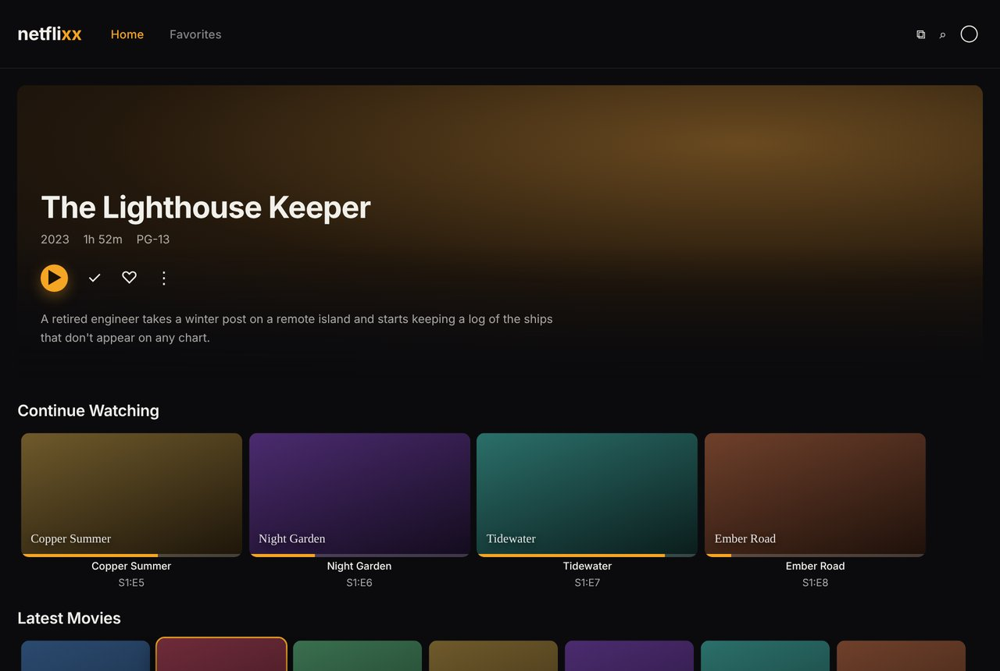

# Netflixx

The media stack on `stx-server`: Jellyfin for watching, Seerr for requesting, and the apps
that find, download, rename and subtitle what gets requested. One compose file, one
command to start or update it.

```
Seerr ──▶ Sonarr / Radarr ◀── Prowlarr (indexers)
               │
               ▼
     qBittorrent ── inside ──▶ Gluetun (VPN)
               │
               ▼  hardlink, no copy
   /srv/data/media ──▶ Jellyfin ──▶ iPhone, TV, laptop
                    └─▶ Bazarr (subtitles)
```

| App | Port | Does |
| --- | --- | --- |
| Seerr | 5055 | Request a movie or show. The one page you use day to day. |
| Sonarr | 8989 | TV: watches for episodes, grabs them, renames and files them. |
| Radarr | 7878 | Movies: the same job. |
| Prowlarr | 9696 | Holds the indexer list and pushes it to Sonarr and Radarr. |
| qBittorrent | 8081 | Downloads. Lives inside Gluetun's network, so no VPN means no traffic. |
| Bazarr | 6767 | Fetches subtitles for everything in the library. |
| Jellyfin | 8096 | Streams it all, with Intel Quick Sync transcoding. |
| AdGuard Home | 3053 | Blocks ads and tracking for the TV, by DNS. Separate, in `adblock/`. |

qBittorrent is on 8081 because openGym's web container already has 8080.

## Set up on stx-server

### 1. Mount the media drive

Use the internal 1 TB Seagate HDD; it's always connected, unlike the USB SSD. Find it:

```bash
lsblk -o NAME,SIZE,MODEL,FSTYPE,MOUNTPOINT
```

It's the 931G disk with model ST1000…, probably `sda`. **Formatting erases it**, so copy
off anything you want first. Make one partition and an ext4 filesystem on it:

```bash
sudo parted /dev/sda --script mklabel gpt mkpart media ext4 0% 100%
```

```bash
sudo mkfs.ext4 -L media /dev/sda1
```

Mount it at `/srv/data` on every boot. `nofail` lets the server still boot if the drive
ever dies:

```bash
sudo mkdir -p /srv/data
echo "UUID=$(sudo blkid -s UUID -o value /dev/sda1) /srv/data ext4 defaults,noatime,nofail 0 2" | sudo tee -a /etc/fstab
sudo systemctl daemon-reload && sudo mount -a && df -h /srv/data
```

`fstab` is the list of drives Linux mounts at boot. Using the UUID instead of `/dev/sda1`
means it still finds the right drive if plugging in the USB SSD shuffles the names.

### 2. Start the stack

```bash
git clone https://github.com/isaacxj/Netflixx.git ~/netflixx && cd ~/netflixx
cp .env.example .env && nano .env      # VPN key and address; check PUID/PGID with `id`
scripts/setup.sh
docker compose up -d
scripts/check.sh
```

`check.sh` confirms every container runs, qBittorrent's public address is the VPN's and
not home's, hardlinks work, and Jellyfin can see the Intel GPU. If the VPN check fails,
stop qBittorrent before doing anything else.

### 3. Connect the apps, in this order

Open each at `http://stx-server:<port>` from a device on the tailnet. Each one asks you to
create a login the first time; do it.

1. **qBittorrent** (8081): the first password is in `docker logs qbittorrent`. Change it.
   Under Downloads, default save path `/data/torrents`. Add categories `tv` →
   `/data/torrents/tv` and `movies` → `/data/torrents/movies`. Under Web UI, tick
   **Bypass authentication for clients on localhost**: that's how Gluetun hands
   qBittorrent the VPN's forwarded port (more peers, faster downloads) each time it changes.
2. **Sonarr** (8989): Media Management → root folder `/data/media/tv`, and turn on
   "Use Hardlinks instead of Copy". Download Clients → qBittorrent, host `gluetun`,
   port `8081`, category `tv`.
3. **Radarr** (7878): the same, with `/data/media/movies` and category `movies`.
4. **Prowlarr** (9696): add your indexers. Settings → Apps → add Sonarr
   (`http://sonarr:8989`) and Radarr (`http://radarr:7878`) with their API keys
   (Settings → General in each).
5. **Bazarr** (6767): connect Sonarr and Radarr the same way, then pick languages and
   subtitle providers.
6. **Jellyfin** (8096): libraries Movies → `/data/media/movies`, Shows → `/data/media/tv`.
   Dashboard → Playback → Transcoding: **Intel QuickSync (QSV)**, device
   `/dev/dri/renderD129` (the one `check.sh` printed). Tick hardware decoding for
   H264, HEVC and VP9, and leave AV1 unticked (the 8th-gen chip can't decode it).
7. **Seerr** (5055): sign in with Jellyfin at `http://jellyfin:8096`, then add Sonarr and
   Radarr.

Containers find each other by name (`sonarr`, `jellyfin`), because compose puts them on one
private network. qBittorrent answers as `gluetun`, since it lives inside that container's
network.

### 4. Watch

Install Jellyfin on the iPhone and add the server as `http://stx-server:8096` (with
Tailscale on). Requests go through Seerr at `http://stx-server:5055`.

## The Netflixx look



`theme/netflixx.css` restyles Jellyfin's own pages: near-black background, a warm amber
accent, the netflixx wordmark in place of Jellyfin's banner, rounded cards with an amber
ring on hover or remote focus, and a filled play button on every movie and episode. It
shows up in the browser, the Jellyfin iPhone app and Jellyfin Media Player, since those all
draw Jellyfin's web pages. Native TV apps draw their own screens and ignore it; the TV
gets its own app later.

Install it once Jellyfin is set up:

1. In Jellyfin, open **Dashboard → API Keys**, press **+**, and name it `netflixx`.
2. Put the key in `.env` as `JELLYFIN_API_KEY=...`.
3. Run `scripts/theme.sh`, then reload Jellyfin.

Run it again after changing the CSS. `scripts/theme.sh remove` puts Jellyfin's own look
back. If there was custom CSS before, the script saves it to
`config/jellyfin-custom-css.backup` first. The colors are variables at the top of the
file: change `--nx-accent` for a different accent.

If a user has turned on "Disable server-provided custom CSS" in their own display
settings, they won't see it.

## Block ads on the TV

AdGuard Home runs as a DNS server on stx-server. When the TV asks where an ad or tracking
domain lives, AdGuard answers "nowhere", so the ad never loads. It's in `adblock/`, its
own compose project, so updating the media stack never takes DNS down.

```bash
cd ~/netflixx && scripts/adblock-setup.sh
```

The script starts it, sets the admin password, adds smart-TV and Fire TV blocklists on top
of AdGuard's defaults, and prints what to type into the TV. The admin page is
`http://stx-server:3053`; its Query Log shows every lookup the TV makes and what got
blocked.

**Pointing the TV at it.** AT&T's BGW320 can't hand out a different DNS server to devices,
so the TV gets it set by hand: on the Fire TV, forget the Wi-Fi, join again, and choose
Advanced. Use a fixed address below `.64` (the gateway hands out `.64` and up), gateway
`192.168.1.254`, prefix `24`, and `192.168.1.134` as DNS. Don't put a public DNS like
`1.1.1.1` in the second slot, or the TV quietly uses it for some lookups and ads come back.

What to expect:

- Banner ads and most sponsored tiles on the Fire TV home screen go blank or disappear, and
  the TV stops reporting what you watch. Amazon serves some promotions from the same
  servers as the home screen itself, so a few stay; blocking those breaks the home screen.
- If an app stops working, find its blocked lookups in Query Log and press Unblock. If a
  whole list causes trouble, switch it off under Filters, DNS blocklists.
- If stx-server is off, the TV can't look anything up. stx-monitor alerts you when
  `adguard` stops, and the quick fix is setting the TV's network back to automatic.

## Day to day

- **Update**: the Update button in stx-monitor's Control center, one app at a time, or
  everything at once with `docker compose pull && docker compose up -d`.
- **Back up** `~/netflixx/config/`. That's every app's settings and history. The media
  itself can be found again; the settings are an evening's work.
- **Logs**: stx-monitor's Logs page, or `docker compose logs -f sonarr`.
- **Update AdGuard**: `docker compose -f adblock/compose.yaml pull` then
  `docker compose -f adblock/compose.yaml --env-file .env up -d`.

## Good to know

- Docker publishes ports around ufw, so these apps are reachable from the home network
  and the tailnet. The router forwards nothing, so not from the internet. Keep a login on
  every app anyway.
- Gluetun is labelled `stx.protected`, so the console can't stop it by mistake and leave
  qBittorrent cut off.
- Downloading something you don't have the rights to is copyright infringement in the US,
  VPN or not. Use the stack for media you own, public-domain films and Linux ISOs.
